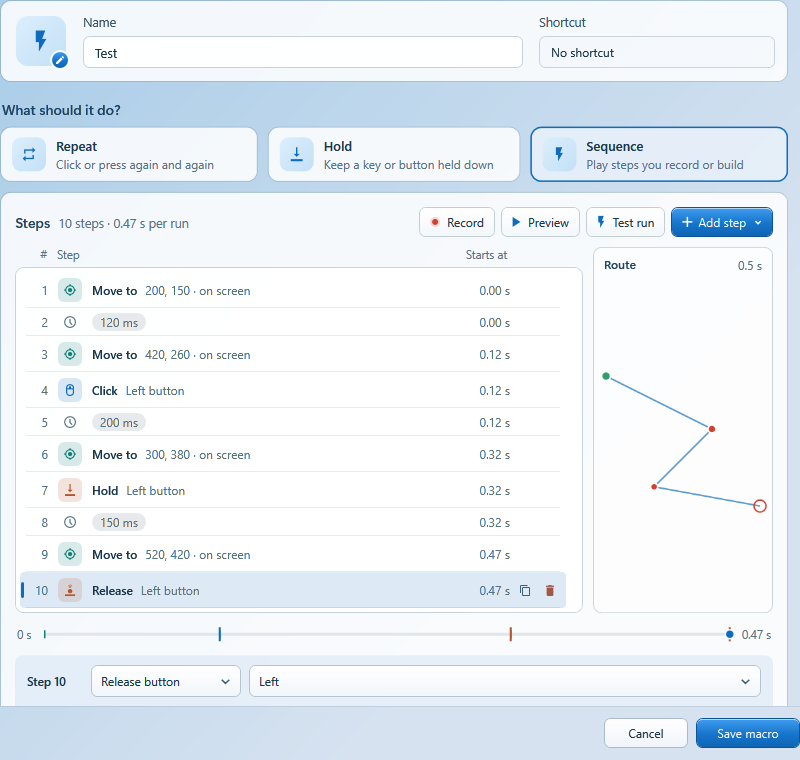
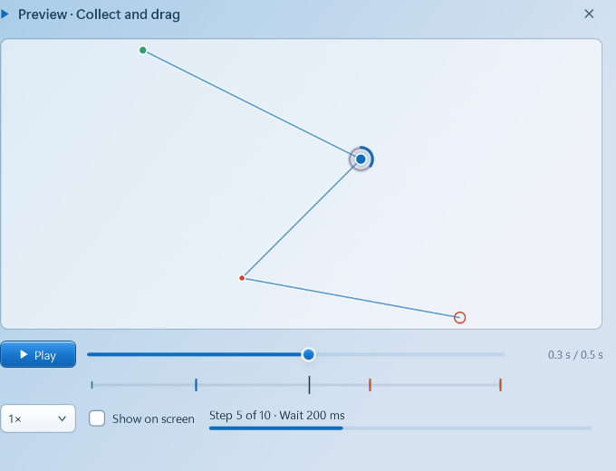

<div align="center">


# Keyloom

**Keyboard and mouse macros for Windows.**<br>
Repeat a click, hold a key, or build a sequence of steps and play it with a shortcut.

[](https://github.com/Shurielx/KeyLoom/releases)
[](https://github.com/Shurielx/KeyLoom/actions/workflows/build.yml)


[Download](https://github.com/Shurielx/KeyLoom/releases) · [Changelog](CHANGELOG.md) · [Build from source](#build)


</div>

## What it does

| | |
|---|---|
| **Repeat** | Click or press a key again and again, as often as every 1 ms. |
| **Hold** | Keep a key or mouse button held down until you stop it. |
| **Sequence** | Clicks, holds, keys, waits, cursor moves, scrolling and text, recorded or built step by step. |

- One window: the editor, settings and help open as pages, and dialogs appear inside it.
- Shortcuts work everywhere, even while Keyloom sits in the tray. **Ctrl + Shift + F12** stops everything.
- Clicks land where you picked them inside a window, and follow it when it moves. Games get a moment to see the cursor before the click.
- Steps can find a picture or a color on the screen: click it wherever it is, wait until it shows up or goes away, or play some steps only if it is there.
- **Experimental:** build a macro right on the screen, and run modes for games that keep your mouse free.
- Light and dark themes, Windows 11 glass, and text that stays sharp on 1080p and 4K screens alike.
- Everything stays on your PC. Keyloom only goes online to check for updates while the About page is open.

## Get started

1. Download the Windows x64 ZIP from [Releases](https://github.com/Shurielx/KeyLoom/releases), extract it and run `Keyloom.exe`. No installer, no admin rights, no .NET install.
2. Click **New macro**, give it a name and pick **Repeat**, **Hold** or **Sequence**.
3. Set a shortcut, then press **Start** or the shortcut. Press it again to stop.

In the list, click a macro's **name**, **icon** or **shortcut** to change it right there. The pencil opens the full editor.

## Sequences



Steps read like a table: the number, what the step does and **when it starts** in a run, counting the waits before it. Under the list, the **run strip** shows the whole run on one line, every input at its time. Hover a mark to see the step, click it to jump there. When the macro moves the pointer, its route sits beside the list.

- **Record** your mouse and keyboard, or add steps by hand with **Add step**.
- **Pick several** steps with Ctrl or Shift and change them together: waits take `100`, `+20`, `-20` or `x1.5`.
- **Drag** rows to reorder them, or use **Alt + ↑ / ↓**.
- **Groups** (Ctrl + G) repeat their steps and can add a wait between them, so a click every 100 ms is one setting instead of a column of copies.
- **Right-click** to insert waits, duplicate several times, copy, cut and paste. Hover the line between two rows for **+ Wait**.
- **Ctrl + Z / Y** undo and redo. Copied steps can be pasted into another macro.

### Preview and test run



**Preview** is a dry run. It plays the route with a moving marker and a countdown for each wait, or, when nothing moves the pointer, shows the step playing now with the ones before and after it. It never moves your pointer or sends input. **Show on screen** draws the route exactly where it will run.

**Test run** plays the macro once for real, without saving it. Keyloom steps out of the way while it runs and comes back when it's done.

## Finding things on the screen

A sequence can look at the screen instead of clicking fixed spots.

- **Add step → Click on something on the screen** finds a picture or a color and clicks its middle, wherever it moved to. **Wait until something shows** holds the macro until it appears, or until it is gone (a loading screen, say).
- **New picture** hides Keyloom and freezes the screen; drag around a button, an icon or a bit of text. **New color** takes the color you click. Esc cancels both. Keep pictures small and distinctive.
- Each picture or color becomes a *target* with a name. Several steps can use the same one, and **Find it now** checks that Keyloom sees it.
- **Tolerance** lets the screen look a little different and still count. **Only look near where it was** is faster and ignores the same thing elsewhere.
- A step that looks for a target keeps trying for the time you set, then goes on, or stops the macro if you ask it to.
- **Add step → If something is on the screen** puts the picked steps in an If: they play only when the target is there (or, if you choose, when it is not). **Add Else** adds steps for the other case. Ifs fold, move and nest like groups.

Keyloom reads what the screen shows, so the target has to be visible: not covered, and not in a minimized window.

## Cursor positions and other windows

**Pick point** lets you click once inside another window. Keyloom remembers the window and the spot, so clicks follow it when the window moves, and can scale with it when it's resized. The click you pick with never reaches the app; Esc cancels.

- **Add step → Click at a point** adds a cursor position and a click; **Cursor to a point** adds only the cursor position.
- Pick a *Cursor position* step to **pick its point again**, add or remove the **click after moving**, or set **Glide** to move the cursor there over that many milliseconds instead of jumping.
- **Click delay after moving** (next to the run settings, 20 ms by default) makes a click or hold wait at least that long after the cursor arrives. Games read input once per frame; without it, a click can land before the game sees the cursor there. A Wait step before the click counts toward it, and 0 clicks right away.

<details>
<summary><b>Macro builder (experimental)</b></summary>
<br>

Turn on **Settings → Features → Macro builder**. **Build on screen** in the steps card then hides Keyloom and covers the screen with the macro's points, numbered in the order they play. Each point is a cursor position and whatever happens there: clicks, holds, waits, keys or text. It works, but it is still rough around the edges.

- **Left click** picks a point and drags it; Ctrl+click picks more. Nothing is added by accident.
- **Right click** on empty space adds a point there (*Click here*, *Hold here*, *Cursor here*) or steps at the end. Right click on a point adds steps to it, switches between jumping and gliding there, groups, duplicates or deletes it.
- A **dashed** line jumps the cursor to the next point, a **solid** one glides it. The time on a line is how long the macro stays at a point before going on; click it to change it.
- The **panel** shows the picked point as a small timeline: how the cursor gets there, each step with the time it starts after the cursor arrives, and the wait before the next point. A hold is one row, like *Hold Left for 200 ms*; for keys, click the field and press the key. **All steps** lists the whole macro with start times, groups and the click delay. Drag the panel by its title or hide it with **H**.
- A **group** plays its points together: *Repeat* sets how many times in a row, *Extra wait* adds a pause after every step inside it (usually 0).

| Keys | In the builder |
|---|---|
| <kbd>Esc</kbd> | Unpick, then finish |
| <kbd>Delete</kbd> | Delete the picked points |
| <kbd>Ctrl</kbd> + <kbd>G</kbd> / <kbd>D</kbd> / <kbd>A</kbd> | Group, duplicate, pick all |
| <kbd>Ctrl</kbd> + <kbd>Z</kbd> | Undo |
| <kbd>H</kbd> | Hide or show the panel |

**Done** puts the steps in the editor and brings Keyloom back; one Ctrl+Z there brings back what was there before.

</details>

<details>
<summary><b>Run modes for games (experimental)</b></summary>
<br>

Turn on **Settings → Features → Experimental features**, then choose a run mode under **More options** in the editor. Both need a target window picked with **Pick point**; **Send a test input** checks that it reacts.

- **Background** sends clicks and keys straight to the window, so your own mouse and keyboard stay free. Many games, Roblox included, ignore it.
- **Quick switch** works with those games. For each burst of input it brings the window forward for a moment, sends real input at the point, then hands your window back. With **Put my cursor back after each step** (on by default) your cursor returns to where you left it, so you can keep working between steps. Best for inputs a second or more apart. The game can sit behind other windows or on another monitor, but not minimized.

</details>

## While a macro runs

The macro's row shows how long it has been running and how many repeats it made, and a small card on screen says what runs and how to stop it. The card lets clicks through. Move it, or turn it into a short notice, under **Settings → While a macro runs**.

**Settings → Usage** keeps simple statistics: how often each macro started, how long it ran, how many repeats it made and when you last used it. Test runs don't count, and **Reset** starts over.

## Shortcuts

| Keys | Action |
|---|---|
| <kbd>Ctrl</kbd> + <kbd>Shift</kbd> + <kbd>F12</kbd> | Stop all macros |
| <kbd>F8</kbd> | Stop recording |
| <kbd>Esc</kbd> | Cancel picking, close a dialog or leave the editor |
| <kbd>Ctrl</kbd> + <kbd>G</kbd> / <kbd>Ctrl</kbd> + <kbd>Shift</kbd> + <kbd>G</kbd> | Group / ungroup picked steps |
| <kbd>Ctrl</kbd> + <kbd>C</kbd> <kbd>X</kbd> <kbd>V</kbd> <kbd>D</kbd> | Copy, cut, paste, duplicate steps |
| <kbd>Ctrl</kbd> + <kbd>Z</kbd> / <kbd>Ctrl</kbd> + <kbd>Y</kbd> | Undo / redo |
| <kbd>Delete</kbd>, <kbd>Alt</kbd> + <kbd>↑</kbd> <kbd>↓</kbd> | Remove or move steps |

Macro shortcuts need Ctrl, Alt or Win with a key, or an F-key on its own.

## Your data

Macros, settings, icons and usage live in `%APPDATA%\Keyloom`, with a backup of your macros on every save. Macros are in `macros.keyloom`, plain JSON you can read and edit; [docs/FORMAT.md](docs/FORMAT.md) describes it, and an AI tool given that page can write macros for you. Macros from Keyloom 0.2 move there on the first start. To share macros or move them to another PC, use the folder button on the macro list: export all of them or one, and import a `.keyloom` file (or drop it on the window). Imported macros are added beside yours; a shortcut you already use comes in unset. Closing the window keeps Keyloom in the tray; use the tray menu to exit.

## Build

Requires Windows and the [.NET 10 SDK](https://dotnet.microsoft.com/download/dotnet/10.0). For local use, double-click **Start Keyloom.bat**: it builds the current source and opens the app.

```powershell
dotnet build Keyloom.csproj -c Release
dotnet run --project tests/Keyloom.Tests.csproj -c Release
dotnet run --project Keyloom.csproj
```

## Good to know

- Builds are unsigned while Keyloom is in development, so Windows may ask before the first start.
- Some apps reject synthetic input, and some games forbid automation in their rules. Check before you use it there.
- One macro runs at a time. Sequences hold up to 20,000 steps; recordings stop after 10 active minutes.
- Macros with groups need Keyloom 0.1-dev-4 or newer. Older versions play a glide as a jump and skip the click delay.
- See the [validation notes](docs/VALIDATION.md) for what has been tested.
