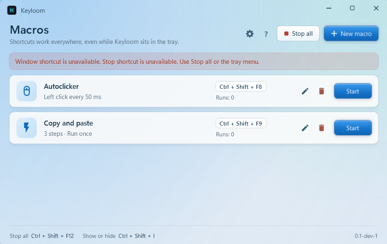

# Keyloom

Simple keyboard and mouse macros for Windows. **Alpha-01**, with an Aero-inspired desktop interface.



## Use

Download the Windows x64 ZIP from [Releases](https://github.com/Shurielx/KeyLoom/releases), extract it, and run `Keyloom.exe`. No .NET installation, administrator access, or special keyboard is required.

1. Add a macro and choose **Repeat input**, **Hold input**, or **Sequence**.
2. Set your input, timing, and optional shortcut.
3. Press **Start** or use the shortcut. Press it again to stop.

Sequences support clicks, key combinations, key down/up, delays, relative movement, pointer positions, scroll, and Unicode text. Use **1 run** to execute once or **0** to loop. One macro runs at a time.

- **Ctrl + Shift + F12** — stop all macros.
- **Ctrl + Shift + I** — show or hide Keyloom.
- Closing the window keeps it in the tray; use the tray menu to exit.

Profiles are stored in `%APPDATA%\Keyloom`, with a backup on save. Existing KeychronHUD profiles are imported automatically.

## Record

Click **Record** in the macro editor, choose what to capture, then switch to your target window during the 3-second countdown. **F8** or the recording panel stops capture; the panel also supports pause/resume.

Keep recorded delays or add your own with **Delay**. Steps can be edited, duplicated, reordered, appended, or replaced. New recordings default to one run. Pointer positions use screen coordinates, so keep the same monitor/window arrangement for playback.

Capture is active only while recording. Keyloom's own controls and synthetic input are excluded. Recordings stay local and are saved only with the macro. Sequences are limited to 20,000 steps; recording stops after 10 active minutes or at the step limit.

## Build

Requires Windows and the [.NET 10 SDK](https://dotnet.microsoft.com/download/dotnet/10.0).

```powershell
dotnet build Keyloom.csproj -c Release
dotnet run --project tests/Keyloom.Tests.csproj -c Release
dotnet run --project Keyloom.csproj
```

Alpha builds are unsigned. Some apps reject synthetic input, and game rules may restrict automation. See [validation notes](docs/VALIDATION.md) for what was tested.
